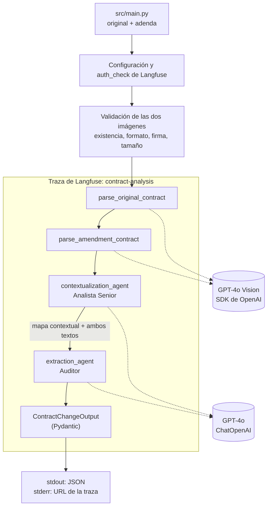

# LegalMove AI — Comparación de contratos con Vision y dos agentes

CLI en Python que recibe dos imágenes (contrato original y adenda), las transcribe con GPT-4o Vision, las analiza con dos agentes especializados de LangChain y devuelve un JSON validado por Pydantic con las secciones modificadas, los temas afectados y un resumen de cada cambio. Cada ejecución queda trazada en Langfuse.

El diseño completo, las decisiones y la evidencia de cada verificación están en [`docs/architecture.md`](docs/architecture.md). Los casos de prueba y sus resultados esperados, en [`data/test_contracts/README.md`](data/test_contracts/README.md).

## Arquitectura



| Archivo | Responsabilidad |
|---|---|
| `src/main.py` | CLI, `run_pipeline()`, spans de Langfuse, códigos de salida |
| `src/image_parser.py` | `parse_contract_image()`: validación, base64 y llamada a GPT-4o Vision |
| `src/agents/contextualization_agent.py` | Agente 1: mapa contextual que relaciona las secciones de ambos documentos |
| `src/agents/extraction_agent.py` | Agente 2: cambios estructurados a partir del mapa |
| `src/models.py` | `ContractChangeOutput` |
| `src/tracing.py` | Observabilidad aislada: una falla de Langfuse nunca reemplaza el resultado ni el error del análisis |
| `src/config.py` / `src/errors.py` | Configuración validada y errores propios |

### Flujo y handoff entre agentes

1. **Parsing (Vision).** Cada imagen se valida (extensión, firma de bytes, tamaño), se codifica en base64 y se envía a GPT-4o con `detail: high` y `temperature=0`. El prompt pide una transcripción literal en Markdown (`#` título, `##` cláusulas), sin normalizar montos ni fechas, y marcar `[ILEGIBLE]` en lugar de adivinar.
2. **Agente 1 — Analista Senior.** Recibe los dos textos y responde "¿dónde mirar?": clasifica la adenda (`REESCRITA`, `INSTRUCTIVA`, `INDETERMINADA`) y arma una tabla que relaciona cada cláusula por contenido y título (`AMBOS`, `SOLO_ORIGINAL`, `SOLO_ADENDA`, `REFERENCIADA`, `AMBIGUA`). No describe cambios.
3. **Agente 2 — Auditor.** Recibe el mapa y los dos textos y responde "¿qué cambió?": compara las secciones relacionadas, etiqueta cada cambio como `[ADICIÓN]`, `[ELIMINACIÓN]` o `[MODIFICACIÓN]` y cita los valores anteriores y nuevos.
4. **Validación.** La salida del Auditor usa structured output (`json_schema`, `strict: true`) con `ContractChangeOutput`. Pydantic valida además la coherencia entre campos: sin identificadores repetidos, resumen no vacío, cada línea con el formato `[ETIQUETA] Cláusula N – Título: descripción`, las mismas cláusulas en el resumen que en `sections_changed`, y "No se detectaron cambios" solo con listas vacías. El mapa del Analista también se valida (tabla, columnas y correspondencias permitidas) antes de pasarlo al Auditor.

El mapa es el contrato entre los agentes: el Auditor no rehace la correspondencia, y si el Analista marca una fila `AMBIGUA` el pipeline se detiene antes de extraer.

### Salida

```json
{
  "sections_changed": ["Cláusula 3"],
  "topics_touched": ["Precio"],
  "summary_of_the_change": "[MODIFICACIÓN] Cláusula 3 – Precio: la tarifa mensual pasa de \"USD 1.200\" a \"USD 1.250\"."
}
```

- `sections_changed`: `"Cláusula N"` únicos. Modificaciones y eliminaciones usan el número del original; adiciones, el de la adenda.
- `summary_of_the_change`: una línea por cambio, con etiqueta.
- Sin cambios: listas vacías y `"No se detectaron cambios"`, solo después de un análisis completo.

## Setup

Requiere Python 3.12.

```bash
python3.12 -m venv .venv
source .venv/bin/activate
pip install -r requirements.txt
cp .env.example .env   # completar las claves
```

| Variable | Obligatoria | Uso |
|---|---|---|
| `OPENAI_API_KEY` | Sí | OpenAI |
| `LANGFUSE_PUBLIC_KEY`, `LANGFUSE_SECRET_KEY`, `LANGFUSE_HOST` | Sí (salvo `--sin-trazas`) | Langfuse |
| `OPENAI_MODEL` | No (`gpt-4o`) | Modelo de Vision y de los agentes |
| `OPENAI_TIMEOUT_SECONDS` | No (`60`) | Timeout por intento |
| `OPENAI_MAX_RETRIES` | No (`2`) | Reintentos del SDK ante timeouts, 429 y 5xx |

## Uso

```bash
# Caso simple: una cláusula modificada
python -m src.main data/test_contracts/documento_3b__original.jpg data/test_contracts/documento_3b__enmienda.jpg

# Caso complejo: modificaciones, una eliminación parcial y una cláusula nueva
python -m src.main data/test_contracts/documento_1__original.jpg data/test_contracts/documento_1__enmienda.jpg
```

stdout contiene solo el JSON; stderr, la URL de la traza y los avisos. `--sin-trazas` desactiva Langfuse (solo para desarrollo, con aviso).

| Exit | Significado |
|---|---|
| 0 | Análisis válido, sin fallas de trazabilidad detectadas |
| 1 | Error inesperado |
| 2 | Entrada inválida, configuración ausente o documento con `[ILEGIBLE]` |
| 3 | Falla de un servicio externo (OpenAI, Langfuse al inicio, respuesta de Vision vacía, rechazada o truncada) |
| 4 | El análisis no produjo un resultado válido (mapa ambiguo, rechazo, truncado, schema inválido, duplicados) |
| 5 | Análisis válido (el JSON se imprime) pero se detectó una falla al registrar la traza |

## Trazabilidad (Langfuse)

```text
contract-analysis                       input: nombres de archivo · output: JSON final
├── parse_original_contract             output: cantidad de caracteres
│   └── vision-transcription            generación: prompt, texto extraído, tokens, latencia
├── parse_amendment_contract
│   └── vision-transcription
├── contextualization_agent             output: mapa contextual
│   └── ContextualizationAgent → ChatOpenAI   (callback de LangChain)
└── extraction_agent                    output: ContractChangeOutput
    └── ExtractionAgent → ChatOpenAI
```

- Vision se instrumenta con una **generación manual**: de la imagen solo se registran nombre, tamaño y MIME, nunca el base64.
- Los agentes usan el `CallbackHandler` de Langfuse. No se usa el wrapper `langfuse.openai`, que duplicaba las generaciones y subía la imagen (verificado; ver D2 en la arquitectura).
- Si una etapa falla, su span y el raíz quedan con nivel `ERROR` y el mensaje del error.
- La observabilidad está aislada del análisis (`src/tracing.py`): si Langfuse falla al crear o actualizar un span, o al enviar la traza, el análisis sigue, su error nunca se reemplaza y el JSON válido se conserva.
- Las fallas de envío se detectan con un handler de logging sobre los loggers de Langfuse y OpenTelemetry (exit 5).

## Pruebas

```bash
pytest                    # 118 tests sin llamadas pagas ni credenciales
pytest -m integration     # pares 3b y 1 con llamadas reales (requiere .env)
```

Los tests habituales simulan OpenAI con un transporte HTTP en memoria (se usa `ChatOpenAI` real, así se verifica también la petición strict) y exportan los spans de Langfuse a memoria. Cubren validación de imágenes (incluidos archivos sin permisos), errores de Vision, mapas inválidos o ambiguos, rechazo, truncado, filtro de contenido, respuestas vacías o incoherentes, duplicados, códigos de salida, fallas de Langfuse inyectadas, jerarquía de la traza, ausencia del base64 y reintentos (3 intentos con `max_retries=2`, sin multiplicarse entre capas). `tests/conftest.py` neutraliza las variables `OTEL_*`, `LANGFUSE_*` y de proxy del entorno, para que el resultado no dependa de la máquina.

Las pruebas de integración comprueban, contra los hechos esperados, las secciones, las etiquetas por cláusula y los valores anteriores y nuevos como números completos (`tests/contract_checks.py`). Esas comprobaciones se prueban a su vez sin costo con resultados incorrectos fabricados. La redacción del resumen se revisa a mano.

## Decisiones técnicas

- **Dos agentes en lugar de uno.** Separar "dónde mirar" de "qué cambió" permite prompts especializados, un artefacto intermedio auditable en la traza y un punto de corte: una correspondencia ambigua detiene el análisis antes de inventar cambios. El flujo es fijo, así que los agentes son cadenas LCEL (prompt + modelo) sin herramientas ni autonomía artificial.
- **GPT-4o para el parsing.** Lee la imagen completa con su jerarquía (títulos, numeración, montos) en una sola llamada, sin OCR intermedio; el mismo modelo sirve para los agentes y se configura con `OPENAI_MODEL`.
- **System prompts.** En español, con un rol definido (Analista Senior / Auditor), responsabilidades excluyentes, criterios de etiquetado con ejemplos, la regla de eliminaciones según el tipo de adenda y un formato de salida fijo.
- **Validación y errores.** Structured output strict + Pydantic; cada falla tiene un error propio y un código de salida. Sin autocorrección: un JSON inválido se informa, no se repara en silencio. Una sola capa de reintentos (el SDK de OpenAI, reutilizado por `ChatOpenAI`), con timeout explícito.
- **`[ILEGIBLE]` detiene el pipeline.** No se compara un documento incompleto: el fragmento faltante podría contener justamente un cambio.

## Limitaciones conocidas

- **Par 1, Cláusula 1:** el Auditor junta en una sola línea `[MODIFICACIÓN]` la eliminación de "e intransferible" y la sustitución de "fines internos de la empresa", aunque el criterio pide separarlas. Vision transcribe bien la cláusula; las secciones y los valores son correctos. La salida varía entre corridas. Con el prompt anterior la eliminación llegó a omitirse; después del ajuste del prompt aparece en 3 de 3 corridas, 1 de ellas en una línea propia.
- Una imagen por documento (sin PDF ni contratos de varias páginas).
- La detección de `[ILEGIBLE]` depende de que el modelo use el marcador; si inventa texto, no es detectable automáticamente.
- Renumeraciones donde un mismo número designa secciones distintas no se pueden representar con identificadores `"Cláusula N"`.
- Los textos completos de los contratos quedan en Langfuse.

## Datos de prueba

| Par | Caso | Resultado esperado |
|---|---|---|
| 3b – SaaS, solo precio | Simple (demo) | `Cláusula 3` |
| 1 – Licencia de software | Complejo (demo) | Cláusulas 1, 2, 3, 4, 5 y 7 (incluye una adición) |
| 2 – Consultoría | Complejo adicional | Cláusulas 1, 2, 3, 4 y 7 |
| 3 – SaaS | Varias modificaciones | Cláusulas 3, 4 y 5 |
| Texto instructivo (`.md`) | Adenda instructiva y eliminación expresa | Cláusulas 2 y 3 |

Las imágenes del par 3b se generan con `scripts/render_test_pair.py` (misma plantilla, solo cambia el precio). El caso instructivo se prueba sin Vision con `python -m spikes.manual_agents data/test_contracts/instructivo__original.md data/test_contracts/instructivo__enmienda.md`.
