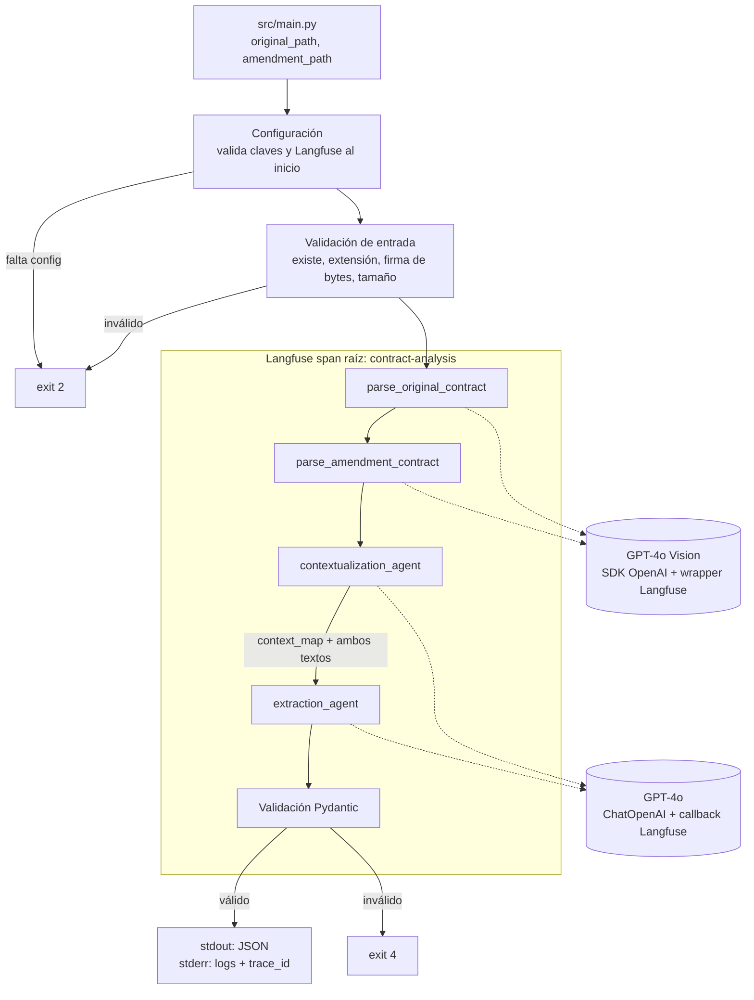

# LegalMove AI — Arquitectura y plan de trabajo

Documento breve de diseño. Los requisitos de la consigna están en `docs/project-requirements.md`.

## 1. Objetivo y alcance

Aplicación CLI en Python que recibe dos imágenes (contrato original y adenda), transcribe ambas con GPT-4o Vision, las analiza con dos agentes especializados (LangChain) y devuelve un JSON validado con Pydantic. Toda la ejecución queda trazada en Langfuse.

**Prioridades:** cumplir la consigna, que el código sea entendible y que cada decisión sea defendible.

**Fuera de alcance:** LangGraph, MCP, RAG, infraestructura cloud, interfaz web, Docker, PDF y contratos de varias páginas, autocorrección del modelo.

## 2. Pipeline



Las etapas son secuenciales. Cada una recibe solo lo que necesita y la configuración llega como un objeto `Settings`; ningún módulo lee el entorno por su cuenta.

## 3. Componentes y contratos

Firmas de referencia; el detalle se define en la etapa correspondiente.

| Archivo | Responsabilidad |
|---|---|
| `src/main.py` | CLI, `run_pipeline()`, span raíz, `flush()` de Langfuse, códigos de salida |
| `src/config.py` | `Settings` inmutable y `load_settings()`; carga `.env` solo cuando se invoca |
| `src/errors.py` | Excepciones propias; cada una se agrega en la etapa que la necesita |
| `src/image_parser.py` | Validación de imagen, base64, llamada a Vision |
| `src/agents/contextualization_agent.py` | Mapa contextual (Analista Senior) |
| `src/agents/extraction_agent.py` | Cambios estructurados (Auditor) |
| `src/models.py` | `ContractChangeOutput` |

### ImageParser

```python
def validate_image_path(image_path: str | Path) -> Path
def encode_image_to_base64(image_path: Path) -> tuple[str, str]   # (base64, mime_type)
def parse_contract_image(image_path: str | Path, *, client=None) -> str
```

- Devuelve Markdown que preserva la jerarquía: títulos, numeración de cláusulas, montos, fechas y nombres tal como aparecen.
- Transcripción literal en el idioma original. Marca `[ILEGIBLE]` y no completa por inferencia.
- No interpreta ni compara.
- Falla con `ImageParsingError` si la respuesta está vacía, solo contiene `[ILEGIBLE]`, el modelo se niega o la salida se truncó.

### ContextualizationAgent

```python
class ContextualizationAgent:
    def __init__(self, llm: BaseChatModel)
    def run(self, original_text: str, amendment_text: str) -> str   # context_map
```

Responde "¿dónde mirar?": clasifica la adenda (instructiva o reescrita), alinea las secciones de los dos documentos, fija el identificador de cada sección y describe el propósito de cada bloque. **No describe cambios.**

Formato del mapa:

```text
## Tipo de adenda: INSTRUCTIVA | REESCRITA
## Mapa de secciones
| ID original | ID en adenda | Propósito | Correspondencia |
  Correspondencia: AMBOS | SOLO_ORIGINAL | SOLO_ADENDA | REFERENCIADA | INCIERTA
## Observaciones
```

### ExtractionAgent

```python
class ExtractionAgent:
    def __init__(self, llm: BaseChatModel)
    def run(self, context_map: str, original_text: str, amendment_text: str) -> ContractChangeOutput
```

Responde "¿qué cambió?": compara las secciones correspondientes, clasifica cada cambio, cita los valores anteriores y nuevos, y produce la salida estructurada. No re-mapea la estructura ni da opiniones legales.

### ContractChangeOutput

```python
class ContractChangeOutput(BaseModel):
    sections_changed: List[str]       # IDs tal como figuran en el original, ej. "Cláusula 3"
    topics_touched: List[str]         # ej. "Precio", "Plazo", "Protección de datos"
    summary_of_the_change: str        # una línea por cambio, con etiqueta
```

Formato del resumen:

```text
[MODIFICACIÓN] Cláusula 3 – Pago: tarifa anual de USD 12.000 a USD 15.000.
[ADICIÓN] Cláusula 7 – Protección de Datos: nueva obligación de cumplir la normativa aplicable.
[ELIMINACIÓN] Cláusula 1 – Otorgamiento de Licencia: se elimina el carácter intransferible.
```

Si no hay cambios: listas vacías y `"No se detectaron cambios"`.

### CLI

```text
python -m src.main <original> <adenda> [--sin-trazas]
stdout: solo el JSON validado
stderr: logs y trace_id
exit: 0 ok | 1 inesperado | 2 entrada o configuración | 3 servicio externo | 4 salida inválida
```

## 4. Decisiones

| # | Decisión | Motivo principal |
|---|---|---|
| D1 | Dos clases con prompt y lógica propios, LCEL (prompt + modelo), sin tools ni autonomía | El flujo es fijo; separar roles mejora los prompts y permite auditar el mapa intermedio |
| D2 | Vision con SDK de OpenAI + wrapper de Langfuse; agentes con callback de LangChain. **Sujeto a verificación (etapa 1b)** | Llamada explícita a la API como pide la consigna; tokens registrados automáticamente |
| D3 | Structured output con Pydantic. Errores de API, rechazo y respuesta truncada se manejan aparte de `ValidationError`. Sin autocorrección | Un JSON inválido se detecta, no se repara en silencio |
| D4 | Exactamente los 3 campos; tipo de cambio expresado con etiquetas en el resumen | Respeta el contrato de la consigna |
| D5 | Vision devuelve `str` Markdown fiel; no interpreta | Separar transcripción de análisis |
| D6 | GPT-4o para todo, configurable por variables de entorno | Una sola variable a defender |
| D7 | Langfuse obligatorio. Falta de configuración → exit 2; servicio caído o credenciales rechazadas → exit 3, antes de gastar tokens. `--sin-trazas` solo para desarrollo, con aviso visible | La observabilidad es parte de la evaluación; no se ocultan fallos |
| D8 | Una sola capa de reintentos (SDK de OpenAI, reutilizada por `ChatOpenAI`). Timeout 60 s, 2 reintentos, configurables. Sin reintentar errores de entrada ni de validación | Evita multiplicar intentos; tiempos predecibles |
| D9 | "Sin cambios" solo después de parsing y análisis exitosos; texto vacío o ilegible es error | Un fallo nunca se presenta como resultado |
| D10 | Prompts y salida en español; transcripción en el idioma original | Coherencia con los documentos y la defensa |
| D11 | Python 3.12, `venv` + `pip install -r requirements.txt`, versiones fijadas, pytest. Tests de integración solo con `-m integration` | Un único mecanismo de instalación; tests habituales gratis |
| D12 | Pares de prueba de `data/test_contracts/` con diferencias esperadas corregidas (sección 7) | Medir exactitud, no solo formato |

**Tiempo de ejecución con D8:** una ejecución típica debería tardar entre 1 y 2 minutos (a medir). En el peor caso, cada una de las 4 llamadas puede tardar unos 3 minutos (3 intentos de 60 s más esperas), unos 13 minutos en total.

## 5. Errores

| Situación | Manejo |
|---|---|
| Falta `OPENAI_API_KEY` o claves de Langfuse | `ConfigError` con la lista de faltantes, exit 2 |
| Langfuse inaccesible o credenciales rechazadas | Error de servicio externo, exit 3, antes de llamar a OpenAI |
| Imagen inexistente, extensión o firma inválida, vacía o demasiado grande | `InputValidationError`, exit 2, sin llamar a la API |
| Timeout, 429, 5xx, conexión | Reintentos del SDK; si se agotan, exit 3 |
| 401 o contexto excedido | Sin reintento, mensaje específico, exit 3 |
| Vision vacía, ilegible, rechazo o truncada | `ImageParsingError` |
| Mapa contextual vacío | `AgentError` |
| Rechazo o salida que no cumple el schema | Se registra la respuesta cruda en el span, exit 4 |

Todo error capturado se registra en el span de su etapa.

## 6. Trazabilidad

```text
contract-analysis                (span raíz: paths, modelo, trace_id)
|-- parse_original_contract      (metadata del archivo; generación con tokens)
|-- parse_amendment_contract
|-- contextualization_agent      (inputs, context_map, tokens)
`-- extraction_agent             (inputs, JSON validado o error)
```

- No se registra el base64 de las imágenes, solo nombre, tamaño y tipo.
- `flush()` al terminar, porque un CLI de vida corta puede perder trazas pendientes.
- La instrumentación se agrega en cada etapa; la etapa 6 verifica la integración completa.

## 7. Datos de prueba

`data/test_contracts/` contiene 3 pares de imágenes de 1242×1755 px, generadas digitalmente. En los tres casos la adenda es una versión reescrita del contrato.

| Par | Uso | Cambios esperados |
|---|---|---|
| 3 – SaaS | Caso simple | Precio USD 1.200 → 1.250; disponibilidad 99,5% → 99,9%; soporte: correo → correo + tickets en línea |
| 1 – Licencia de software | Caso complejo | Cláusula 1: se elimina "intransferible" y "únicamente para fines internos de la empresa" pasa a "para operaciones internas de negocio"; plazo 12 → 24 meses; pago USD 12.000 → 15.000; soporte: correo → correo + chat; terminación 30 → 60 días; nueva cláusula 7 Protección de Datos |
| 2 – Consultoría | Caso complejo adicional | Alcance: se agrega "análisis regulatorio"; duración 6 → 9 meses; honorarios USD 8.000 → 9.500; entregables mensuales → quincenales; nueva cláusula 7 Propiedad Intelectual |

**Corrección:** el archivo `Diferencias entre Contratos y Enmiendas de ejemplo.docx` omite los dos cambios de la cláusula 1 del par 1. La tabla anterior es la referencia.

**Huecos de cobertura:** ningún par elimina una cláusula completa y ninguna adenda es instructiva. Se podrá agregar un par propio en la etapa 7.

## 8. Testing

- **Unitarios (por defecto, sin red ni credenciales):** configuración, validación de imágenes, modelo Pydantic, armado de prompts, mapeo de errores a códigos de salida.
- **Orquestación con dobles de prueba:** orden de las etapas y entrega del `context_map` al segundo agente. Los clientes y modelos se inyectan por parámetro.
- **Integración (`pytest -m integration`, pagos):** los pares reales. Se comprueba que las secciones esperadas estén incluidas en `sections_changed`.
- **Límite:** los tests verifican formato y flujo. La exactitud legal se revisa contra la sección 7.

## 9. Riesgos

- Errores de transcripción en números y fechas que se reporten como cambios reales.
- Superposición entre agentes: que el primero empiece a describir cambios.
- Identificadores de sección inconsistentes ("Cláusula 3", "3", "Tercera").
- Integración entre openai 3.x, langfuse 5.x y langchain 1.7 no verificada todavía.
- Textos completos de contratos almacenados en Langfuse.
- Fallo de la API durante la defensa en vivo: conservar trazas previas como respaldo.

## 10. Decisiones pendientes

- **Etapa 4:** etiquetado por cambio y no por cláusula (recomendado). Ejemplo: eliminar "intransferible" se etiqueta `[ELIMINACIÓN]` aunque la cláusula siga existiendo.
- **Etapa 1b:** confirmar D2, D3 y D8 con las versiones fijadas; si hay problemas, bajar de versión mayor o unificar Vision en `ChatOpenAI`.
- **Etapa 7:** decidir si se crea un par propio con eliminación de cláusula completa.

## 11. Checklist de etapas

Cada etapa se propone, se aprueba, se implementa, se explica y se revisa antes de pasar a la siguiente.

- [x] **M0** Requisitos y diseño (este documento)
- [x] Python 3.12 instalado; OpenSpec retirado del repositorio
- [ ] **1** Estructura, dependencias fijadas, `.env.example`, `config.py`, `errors.py`, tests de configuración
- [ ] **1b** Prueba descartable con claves reales: traza única sin duplicados, structured output strict, conteo de reintentos, verificación de Langfuse al inicio
- [ ] **2** `image_parser.py`: validación, base64, Vision, span de parsing, prueba manual con un par
- [ ] **3** `ContextualizationAgent` con textos de ejemplo y su span
- [ ] **4** `ExtractionAgent` + `ContractChangeOutput` + manejo de validación y rechazo
- [ ] **5** Pipeline completo desde la CLI, códigos de salida, modo `--sin-trazas`
- [ ] **6** Verificación de la traza completa en Langfuse (jerarquía, tokens, latencia, sin duplicados)
- [ ] **7** Casos de prueba y README de `data/test_contracts/`, tests de integración, README principal, preparación de la defensa
