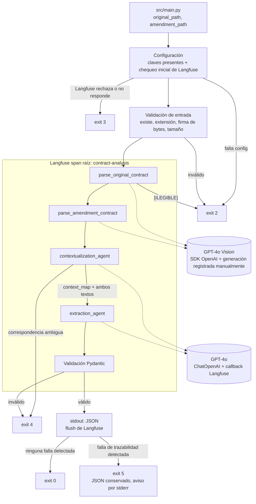

# LegalMove AI — Arquitectura y plan de trabajo

Documento breve de diseño. Los requisitos de la consigna están en `docs/project-requirements.md`. Los resultados esperados de los casos de prueba están en `data/test_contracts/README.md`.

## 1. Objetivo y alcance

Aplicación CLI en Python que recibe dos imágenes (contrato original y adenda), transcribe ambas con GPT-4o Vision, las analiza con dos agentes especializados (LangChain) y devuelve un JSON validado con Pydantic. Toda la ejecución queda trazada en Langfuse.

**Prioridades:** cumplir la consigna, que el código sea entendible y que cada decisión sea defendible.

**Fuera de alcance:** LangGraph, MCP, RAG, infraestructura cloud, interfaz web, Docker, PDF y contratos de varias páginas, autocorrección o reintento correctivo del modelo, LLM evaluador, mecanismo propio de confirmación de entrega de trazas.

## 2. Pipeline



Las etapas son secuenciales. Cada una recibe solo lo que necesita y la configuración llega como un objeto `Settings`; ningún módulo lee el entorno por su cuenta. El `[ILEGIBLE]` aplica a cualquiera de los dos parsings.

## 3. Componentes y contratos

Firmas de referencia; el detalle se define en la etapa correspondiente.

| Archivo | Responsabilidad |
|---|---|
| `src/main.py` | CLI, `run_pipeline()`, span raíz, `flush()` de Langfuse, códigos de salida |
| `src/config.py` | `Settings` inmutable y `load_settings()`; carga `.env` solo cuando se invoca |
| `src/errors.py` | Excepciones propias; cada una se agrega en la etapa que la necesita |
| `src/image_parser.py` | Validación de imagen, base64, llamada a Vision |
| `src/agents/contextualization_agent.py` | Mapa contextual (Analista Senior) |
| `src/agents/extraction_agent.py` | Cambios estructurados (Auditor) |
| `src/models.py` | `ContractChangeOutput` |

### ImageParser

```python
def validate_image_path(image_path: str | Path) -> Path
def encode_image_to_base64(image_path: Path) -> tuple[str, str]   # (base64, mime_type)
def parse_contract_image(image_path: str | Path, *, client: openai.OpenAI, model: str, langfuse: Langfuse | None = None) -> str
```

- Devuelve Markdown que preserva la jerarquía: títulos, numeración de cláusulas, montos, fechas y nombres tal como aparecen.
- Transcripción literal en el idioma original. Marca con `[ILEGIBLE]` todo fragmento que no pueda leer y no completa por inferencia.
- No interpreta ni compara.
- Falla con `ImageParsingError` si la respuesta está vacía, el modelo se niega o la salida se truncó. El SDK no lanza excepción ante una salida truncada: hay que revisar `finish_reason == "length"` explícitamente.

**Instrumentación de Vision (D2).** Se usa el cliente `openai.OpenAI` común, sin el wrapper de Langfuse. Dentro del span de parsing se registra una generación manual (`as_type="generation"`) con: modelo, prompt textual, texto extraído, uso de tokens de `response.usage`, `finish_reason` y, si falla, el error. La latencia surge del inicio y fin de la generación. De la imagen solo se registran nombre de archivo, tamaño y tipo MIME.

**Texto ilegible (limitación deliberada de la primera versión):** cualquier aparición de `[ILEGIBLE]` en cualquiera de los dos textos detiene el pipeline con un error que indica el documento afectado. No se compara un documento incompleto, porque el fragmento faltante podría contener justamente un cambio. Esta situación nunca produce "No se detectaron cambios". La detección depende de que el modelo use el marcador; si en vez de marcar inventa texto, no hay forma de detectarlo automáticamente (ver riesgos).

### ContextualizationAgent

```python
class ContextualizationAgent:
    def __init__(self, llm: BaseChatModel)
    def run(self, original_text: str, amendment_text: str, *, callbacks=None) -> str   # context_map
```

Responde "¿dónde mirar?": clasifica la adenda, relaciona las secciones de los dos documentos, asigna el identificador de cada sección y describe el propósito de cada bloque. **No describe cambios.**

Formato del mapa:

```text
## Tipo de adenda: INSTRUCTIVA | REESCRITA | INDETERMINADA
## Mapa de secciones
| ID original | ID en adenda | Propósito | Correspondencia |
  Correspondencia: AMBOS | SOLO_ORIGINAL | SOLO_ADENDA | REFERENCIADA | AMBIGUA
## Observaciones
```

- **REESCRITA:** la adenda reproduce el contrato completo con sus cambios.
- **INSTRUCTIVA:** la adenda solo enumera modificaciones ("Se modifica la Cláusula 2...").
- **INDETERMINADA:** no se puede decidir; el extractor la trata como instructiva, que es la interpretación más conservadora.

**Correspondencia de secciones.** Las secciones se relacionan por contenido y título, no solo por número. Así, una cláusula renumerada se reconoce como la misma sección.

**Correspondencia ambigua.** Si el agente no puede relacionar una sección con seguridad, la marca `AMBIGUA`. El pipeline detecta ese marcador y se detiene con un error de análisis claro (exit 4) antes de ejecutar el extractor. No se inventa la correspondencia ni se devuelve "sin cambios".

### ExtractionAgent

```python
class ExtractionAgent:
    def __init__(self, llm: BaseChatModel)
    def run(self, context_map: str, original_text: str, amendment_text: str, *, callbacks=None) -> ContractChangeOutput
```

Responde "¿qué cambió?": compara las secciones correspondientes, clasifica cada cambio, cita los valores anteriores y nuevos, y produce la salida estructurada. No re-mapea la estructura ni da opiniones legales.

**Etiquetado (aprobado).** Se aplica **por cambio, no por cláusula**: una misma cláusula puede tener varios cambios de distinto tipo.

| Etiqueta | Criterio | Ejemplo |
|---|---|---|
| `ADICIÓN` | Nueva cláusula u obligación independiente | Se incorpora la cláusula de Protección de Datos |
| `ELIMINACIÓN` | Supresión sin reemplazo | Se quita "intransferible" de la licencia |
| `MODIFICACIÓN` | Sustitución o ampliación de algo existente | Soporte por correo pasa a correo y chat |

**Regla de eliminaciones.** Solo se reporta una eliminación si el texto la respalda:

- En una adenda **REESCRITA**, una cláusula o fragmento del original ausente en la adenda es una eliminación.
- En una adenda **INSTRUCTIVA** o **INDETERMINADA**, la ausencia de una cláusula **no** es una eliminación: solo cuenta si la adenda la elimina expresamente ("se deja sin efecto", "se deroga", "se suprime"). Las cláusulas no mencionadas se consideran sin cambios.

**No son cambios contractuales:** las diferencias propias del formato de una adenda (título, preámbulo "La presente enmienda modifica...") y una renumeración por sí sola, sin cambio de contenido.

### ContractChangeOutput

```python
class ContractChangeOutput(BaseModel):
    sections_changed: List[str]
    # Identificadores "Cláusula N", únicos, en orden de aparición.
    # Modificación o eliminación: número del contrato original.
    # Adición: número de la adenda.
    # Si hay duplicados, la salida es inválida (exit 4); no se normaliza.
    topics_touched: List[str]         # ej. "Precio", "Plazo", "Protección de datos"
    summary_of_the_change: str        # una línea por cambio, con etiqueta
```

`sections_changed` representa secciones únicas: una cláusula con varios cambios aparece **una sola vez** en la lista y **una línea por cambio** en el resumen. Varias líneas sobre la misma cláusula en el resumen son válidas.

Formato del resumen (ejemplo del par 1, parcial):

```text
[ELIMINACIÓN] Cláusula 1 – Otorgamiento de Licencia: se elimina "e intransferible" de la descripción de la licencia.
[MODIFICACIÓN] Cláusula 1 – Otorgamiento de Licencia: "únicamente para fines internos de la empresa" pasa a "para operaciones internas de negocio".
[MODIFICACIÓN] Cláusula 4 – Soporte: de correo electrónico a correo electrónico y chat.
[ADICIÓN] Cláusula 7 – Protección de Datos: nueva cláusula sobre cumplimiento de normativas de protección de datos.
```

Con ese resumen, `sections_changed` sería `["Cláusula 1", "Cláusula 4", "Cláusula 7"]`: la cláusula 1 aparece una vez y la 7 usa el número de la adenda.

Si no hay cambios: listas vacías y `"No se detectaron cambios"`. Solo es válido después de dos parsings exitosos y un análisis completo.

**Limitación inicial (renumeración):** el schema no tiene identificadores compuestos. Si una adenda renumera cláusulas de modo que el mismo identificador designe secciones diferentes (por ejemplo, una nueva "Cláusula 3" de la adenda y la "Cláusula 3" original modificada), `sections_changed` no puede distinguirlas. Este caso no se resuelve en la primera versión; ningún caso de prueba actual lo presenta.

### CLI

```text
python -m src.main <original> <adenda> [--sin-trazas]
stdout: solo el JSON validado
stderr: logs, trace_id y avisos
exit:
  0  análisis válido y ninguna falla de trazabilidad detectada
     (con --sin-trazas: análisis válido, con aviso de modo desarrollo sin observabilidad)
  1  error inesperado
  2  entrada inválida, configuración ausente o documento con [ILEGIBLE]
  3  servicio externo: OpenAI, chequeo inicial de Langfuse, o respuesta de Vision vacía, rechazada o truncada
  4  el análisis no produjo un resultado válido: correspondencia ambigua, salida rechazada,
     fuera del schema o con identificadores duplicados
  5  análisis válido (el JSON se imprime igual) con una falla de trazabilidad detectada
```

Si el análisis falla y además falla la trazabilidad, prevalece el código del análisis y stderr informa ambos fallos.

## 4. Decisiones

| # | Decisión | Motivo principal |
|---|---|---|
| D1 | Dos clases con prompt y lógica propios, LCEL (prompt + modelo), sin tools ni autonomía | El flujo es fijo; separar roles mejora los prompts y permite auditar el mapa intermedio |
| D2 | Vision con el SDK de OpenAI y generación registrada manualmente; agentes con `CallbackHandler` de LangChain. Ningún módulo importa `langfuse.openai` | El wrapper intercepta globalmente el SDK y duplicaba las generaciones de los agentes; cualquier captura automática de Vision sube la imagen a Langfuse (sección 10) |
| D3 | Structured output con Pydantic. Errores de API, rechazo y respuesta truncada se manejan aparte de `ValidationError`. Sin autocorrección | Un JSON inválido se detecta, no se repara en silencio |
| D4 | Exactamente los 3 campos; etiquetado por cambio; identificadores únicos según la sección 3; duplicados rechazados | Respeta el contrato de la consigna sin perder las cláusulas nuevas |
| D5 | Vision devuelve `str` Markdown fiel; no interpreta; `[ILEGIBLE]` detiene el pipeline | Separar transcripción de análisis; no comparar documentos incompletos |
| D6 | GPT-4o para todo, configurable por variables de entorno | Una sola variable a defender |
| D7 | Langfuse obligatorio, con la política de la sección 6. `--sin-trazas` solo para desarrollo, con aviso visible | La observabilidad es parte de la evaluación; no se ocultan fallos |
| D8 | Una sola capa de reintentos (SDK de OpenAI, reutilizada por `ChatOpenAI`). Timeout 60 s, 2 reintentos, configurables. Sin reintentar errores de entrada ni de validación | Evita multiplicar intentos; tiempos predecibles |
| D9 | "Sin cambios" solo después de parsing y análisis exitosos; texto vacío, ilegible, correspondencia ambigua o error nunca lo producen | Un fallo nunca se presenta como resultado |
| D10 | Prompts y salida en español; transcripción en el idioma original | Coherencia con los documentos y la defensa |
| D11 | Python 3.12, `venv` + `pip install -r requirements.txt`, versiones fijadas, pytest. `pytest` por defecto no hace llamadas externas (sección 8) | Un único mecanismo de instalación; tests habituales gratis |
| D12 | Casos de prueba y resultados esperados en `data/test_contracts/README.md` | Medir exactitud, no solo formato |

**Tiempo de ejecución con D8:** una ejecución típica debería tardar entre 1 y 2 minutos (a medir). En el peor caso, cada una de las 4 llamadas puede tardar unos 3 minutos (3 intentos de 60 s más esperas), unos 13 minutos en total.

## 5. Errores

| Situación | Manejo |
|---|---|
| Falta `OPENAI_API_KEY` o claves de Langfuse | `ConfigError` con la lista de faltantes, exit 2 |
| Langfuse inaccesible o credenciales rechazadas al inicio | `auth_check()` lanza una excepción (observado: `httpx.ConnectError` con servidor inaccesible, `UnauthorizedError` con credenciales inválidas) o podría devolver `False`; todos los casos son exit 3, antes de llamar a OpenAI |
| Imagen inexistente, extensión o firma inválida, vacía o demasiado grande | `InputValidationError`, exit 2, sin llamar a la API |
| Timeout, 429, 5xx, conexión | Reintentos del SDK; si se agotan, exit 3 |
| 401 o contexto excedido | Sin reintento, mensaje específico, exit 3 |
| Vision vacía, rechazada o truncada (`finish_reason == "length"`, revisado a mano) | `ImageParsingError`, exit 3 |
| Texto con `[ILEGIBLE]` | `IllegibleDocumentError` indicando el documento, exit 2. No se ejecutan los agentes |
| Mapa contextual vacío o con correspondencia `AMBIGUA` | `AgentError` indicando las secciones afectadas, exit 4. No se ejecuta el extractor |
| Rechazo del extractor, salida truncada o fuera del schema | Se registra la respuesta cruda en el span, exit 4. Son caminos distintos: el rechazo llega como `OpenAIRefusalError` (o como `parsing_error` con `include_raw=True`), la truncada como `openai.LengthFinishReasonError` aun con `include_raw=True`, y el schema inválido como error de validación |
| `sections_changed` con duplicados | Salida inválida con mensaje que nombra el identificador repetido, exit 4. Sin normalización ni reintento |
| Falla de trazabilidad durante la ejecución o en el envío final | Ver sección 6. Si no se puede obtener la URL de la traza (`get_trace_url` consulta la API), se imprime solo el `trace_id` |

Todo error capturado se registra en el span de su etapa, si la trazabilidad está disponible.

## 6. Trazabilidad

```text
contract-analysis                (span raíz: nombres de archivo, modelo, trace_id)
|-- parse_original_contract      (metadata del archivo, texto extraído, tokens, latencia)
|-- parse_amendment_contract
|-- contextualization_agent      (textos de entrada, context_map, tokens, latencia)
`-- extraction_agent             (entradas, JSON validado o error + respuesta cruda, tokens, latencia)
```

**Qué se registra:** texto extraído de cada imagen, mapa contextual, resultado final o error, y métricas (tokens, latencia, modelo, `finish_reason`). Es lo necesario para auditar cómo se llegó al resumen.

**Qué no se registra:** las imágenes ni su base64, ni como texto ni como archivo adjunto de Langfuse; solo nombre, tamaño y tipo MIME. Por eso la llamada de Vision no se captura automáticamente: cualquier captura automática del mensaje con la imagen la sube a Langfuse, y desactivar esa subida deja el base64 dentro del span (sección 10).

**Cómo se instrumenta cada etapa:**

| Etapa | Mecanismo | Generaciones esperadas |
|---|---|---|
| Span raíz y spans de etapa | `start_as_current_observation` propio | — |
| Parsing (x2) | Generación manual dentro del span de parsing | 1 por imagen |
| Agentes | `CallbackHandler` pasado en cada `invoke` | 1 por llamada al modelo |

Ningún módulo importa `langfuse.openai`: al importarse intercepta todo el SDK de OpenAI, incluidas las llamadas internas de `ChatOpenAI`, y duplicaría las generaciones de los agentes.

**Política por momento de falla:**

| Momento | Ejemplo | Resultado |
|---|---|---|
| Chequeo inicial | Claves ausentes / credenciales rechazadas o servicio inaccesible | exit 2 / exit 3, antes de llamar a OpenAI |
| Durante la ejecución | Error al crear un span o registrar datos | El análisis continúa; si termina válido, exit 5 |
| Envío final (`flush`) | Error de exportación detectado | JSON conservado en stdout, explicación en stderr, exit 5 |
| Ninguna falla detectada | — | exit 0 |
| `--sin-trazas` | Modo desarrollo | exit 0 si el análisis es válido, con aviso de que no hubo observabilidad |

**Cómo se detectan las fallas (comportamiento observado en la sección 10):**

- **Chequeo inicial:** `auth_check()`. Una excepción o un `False` son exit 3.
- **Durante la ejecución y en el envío final:** `flush()` devuelve `None` y no lanza excepciones aunque el envío falle. La falla solo aparece como un registro de nivel ERROR en el logger del exportador de OpenTelemetry. Para detectarla se usa un handler de `logging`:
  - Observa los loggers `langfuse` y `opentelemetry.exporter.otlp.proto.http.trace_exporter`.
  - Cuenta los registros de nivel ERROR o superior. El criterio es el nombre del logger y el nivel, no el texto del mensaje. Los WARNING se ignoran: corresponden a reintentos internos del exportador.
  - Se instala al comenzar la ejecución y se retira en un bloque `finally`, después de `flush()`. Si ya hay un handler del CLI instalado, no se agrega otro. Como el CLI hace una ejecución por proceso, los errores registrados en ese intervalo pertenecen a la ejecución actual.
  - Si contó algún error y el análisis es válido: exit 5.

**Límites de esta detección (aceptados):**

- Solo detecta los errores que el SDK expone en los loggers observados. Una falla que no se registre ahí, o que se registre en otro logger o con un nivel menor, pasa inadvertida.
- La ausencia de errores **no confirma** que las trazas se hayan persistido: el servidor podría aceptar el envío y fallar después.
- Depende de nombres de loggers internos de Langfuse y OpenTelemetry. Con las versiones fijadas está verificado; al cambiar de versión hay que volver a verificarlo.
- Un error que el exportador registre después de retirar el handler no se cuenta. Como `flush()` es bloqueante, el envío pendiente se intenta antes de retirarlo.

Por eso exit 0 significa "ninguna falla de trazabilidad detectada", no "persistencia confirmada". La confirmación definitiva es abrir la traza en el dashboard con el `trace_id` que se imprime por stderr. Si en la práctica el handler resulta frágil, se explica antes de agregar complejidad; no se construye un sistema de monitoreo.

La instrumentación se agrega en cada etapa; la etapa 6 verifica la integración completa.

## 7. Datos de prueba

La referencia única de casos y resultados esperados es `data/test_contracts/README.md`. Resumen de roles:

| Caso | Rol | Estado |
|---|---|---|
| Par 3b – SaaS, solo precio | Caso simple de la defensa (una cláusula modificada) | Disponible: `documento_3b__*.jpg`, generado con `scripts/render_test_pair.py` |
| Par 1 – Licencia de software | Caso complejo de la defensa (modificaciones, adición y eliminación) | Disponible |
| Par 2 – Consultoría | Caso complejo adicional | Disponible |
| Par 3 – SaaS | Varias modificaciones, sin adiciones ni eliminaciones | Disponible |
| Texto instructivo | Ausencia ≠ eliminación; eliminación expresa de una cláusula | Disponible: `instructivo__original.md` y `instructivo__enmienda.md` |
| Par 4 – Adenda instructiva | Mismo contenido que el texto instructivo, en imágenes: cubre adenda instructiva y eliminación de cláusula completa | Planificado para la etapa 7 |

**Generación de imágenes nuevas (etapa 7):** determinista, con renderizado de texto a imagen a partir de una plantilla, no con IA generativa. Original y enmienda de cada par se generan con la misma plantilla y solo difieren en el contenido previsto. Ambas imágenes se revisan visualmente antes de aceptarlas.

## 8. Testing y evaluación

**Ejecución por defecto.** `pytest` sin argumentos no realiza llamadas externas ni requiere credenciales. Los clientes y modelos se inyectan por parámetro y se reemplazan por dobles de prueba.

**Pruebas reales (pagas).** Se habilitan solo con un comando explícito, documentado en el README. Un marcador por sí solo no alcanza: la configuración de pytest debe excluirlas por defecto, y además se saltean con un mensaje claro si faltan credenciales. El mecanismo concreto se implementa en la etapa 7.

**Niveles:**

- **Unitarios:** configuración, validación de imágenes, detección de `[ILEGIBLE]` y `AMBIGUA`, modelo Pydantic (incluido el rechazo de duplicados), armado de prompts, mapeo de errores a códigos de salida.
- **Orquestación con dobles:** orden de las etapas y entrega del `context_map` al segundo agente.
- **Integración (pagos):** los casos de `data/test_contracts/`.

**Criterios de evaluación de resultados reales.** Validar el formato no alcanza. Para cada caso se revisa:

| Criterio | Comprobación automática (sencilla) | Revisión manual |
|---|---|---|
| Secciones | `sections_changed` igual al conjunto esperado: sin faltantes **ni sobrantes**; sin duplicados | — |
| Valores | Cada valor anterior y nuevo esperado aparece en el resumen, ignorando separadores de miles y decimales | Que estén asociados a la cláusula correcta |
| Tipo de cambio | Aparece cada etiqueta esperada y no aparece ninguna etiqueta no esperada | Que cada etiqueta corresponda al cambio correcto según el criterio de la sección 3 |
| Cambios inventados | Cubierto en parte por la ausencia de secciones sobrantes | Cada línea del resumen corresponde a un hecho de la lista esperada; una línea sin correspondencia es un cambio inventado |
| Temas | No se comprueba automáticamente | Que sean razonables |

No se exige coincidencia literal del resumen ni se usa un LLM evaluador.

**Fuente de los hechos esperados.** Por ahora la revisión es manual y la referencia es `data/test_contracts/README.md`. Al implementar las pruebas de integración se evaluará un archivo JSON sencillo como fuente única de los hechos que se comprueben automáticamente. No se parsea Markdown ni se construye un generador de documentación o un framework de evaluación.

## 9. Riesgos

- Errores de transcripción en números y fechas que se reporten como cambios reales.
- Que Vision complete texto por inferencia en lugar de marcar `[ILEGIBLE]`; no es detectable automáticamente.
- Que el agente de contextualización no marque `AMBIGUA` cuando corresponde y fuerce una correspondencia incorrecta.
- Superposición entre agentes: que el primero empiece a describir cambios.
- Colisión de identificadores por renumeración (limitación de la sección 3).
- Que algún módulo importe `langfuse.openai` y vuelva a duplicar las generaciones; se cubre con un test.
- Que la detección de fallas de trazabilidad deje de funcionar al actualizar Langfuse u OpenTelemetry (depende de nombres de loggers internos).
- Comportamiento real de la API y del dashboard todavía sin evidencia (sección 10).
- **Observado (01/11/2026):** en el par 1, el extractor junta en una sola línea `[MODIFICACIÓN]` los dos hechos de la Cláusula 1 (1.1 `ELIMINACIÓN` de "e intransferible" y 1.2 `MODIFICACIÓN`), aunque el prompt pide separarlos. La transcripción de Vision es correcta; es un límite del extractor de una sola pasada. Una regla más estricta empeoró el resultado (omitió la eliminación), así que se conservó la versión breve. Las secciones y los valores son correctos.
- Textos completos de contratos almacenados en Langfuse.
- Fallo de la API durante la defensa en vivo: conservar trazas previas como respaldo.

## 10. Verificaciones de integración

### 10.1 Resultados sin costo (31/10/2026)

**Método:** OpenAI simulado con un transporte HTTP en memoria (`httpx2.MockTransport`) y Langfuse con un exportador de spans en memoria (`InMemorySpanExporter`). Sin claves reales ni llamadas pagas. Se reproduce con `spikes/check_1b_offline.py`.

**Versiones:** Python 3.12.16, openai 3.41.0, langchain-core 1.7.3, langchain-openai 1.7.3, langfuse 5.0.4, pydantic 2.14.2.

| Comprobación | Resultado | Consecuencia |
|---|---|---|
| Spans propios + llamadas de Vision y de agentes | Una sola traza, con las etapas como hijas de `contract-analysis` | Jerarquía viable |
| Wrapper `langfuse.openai` + callback | Cada llamada de un agente se registra dos veces (`ChatOpenAI` y `OpenAI-generation`) | El wrapper se descarta (D2) |
| Solo callback, sin importar el wrapper | Una generación por llamada, con tokens | Mecanismo elegido para los agentes |
| Captura automática del mensaje con imagen | La imagen se sube como archivo adjunto de Langfuse | Vision se instrumenta a mano (D2) |
| Desactivar la subida de archivos | El base64 completo queda dentro del span | Descartado |
| Función `mask` del cliente | Se ejecuta después de la subida; no la evita | Descartado |
| Petición de structured output de LangChain | `/v1/chat/completions`, `json_schema`, `strict: true`, 3 campos obligatorios, `additionalProperties: false` | Compatible con D3 y D4 |
| Rechazo y truncado en structured output | Rechazo: `OpenAIRefusalError` (o `parsing_error` con `include_raw=True`). Truncado: `openai.LengthFinishReasonError`, aun con `include_raw=True` | Errores a mapear en la etapa 4 |
| Truncado con el SDK directo | No lanza excepción; solo `finish_reason='length'` | Revisión explícita en la etapa 2 |
| Reintentos con `max_retries=2` ante falla de conexión | 3 intentos con el SDK y 3 con `ChatOpenAI` | Una sola capa (D8) |
| `auth_check()` con servidor inaccesible | Lanza `httpx.ConnectError` | Capturar excepción y `False` |
| `flush()` con envío fallido | Devuelve `None` sin excepción; ERROR en el logger del exportador de OpenTelemetry | Detección por logging (sección 6) |

### 10.2 Verificaciones pendientes, por etapa

Cada una queda pendiente hasta tener evidencia: un test del proyecto o una traza real referenciada en 10.3.

**Etapa 2 (parser, primeras llamadas reales):**
- [x] `auth_check()` con credenciales válidas devuelve `True`; con credenciales inválidas lanza `UnauthorizedError` (no devuelve `False`).
- [x] Llamada real de Vision con un par de prueba: la generación manual muestra modelo, prompt, texto extraído, tokens y latencia.
- [x] En la traza real no aparece la imagen: ni base64 ni archivo adjunto. Lo confirman un test con exportador en memoria y la consulta de la traza por la API de Langfuse.
- [x] Una sola generación por imagen.

**Etapa 3 (primer agente):**
- [x] El callback queda dentro del span `contextualization_agent`, en la misma traza que el parsing.
- [x] Una sola generación por llamada al modelo; ningún módulo importa `langfuse.openai` (test).

**Etapa 4 (extracción):**
- [x] La API real acepta el schema strict de `ContractChangeOutput`.
- [x] Rechazo, truncado, duplicados y schema inválido producen `AgentError` con mensajes distintos (tests con respuestas simuladas). El mapeo a exit 4 se verifica en la etapa 5.

**Etapa 5 (CLI):**
- [x] Reintentos: 3 intentos con `max_retries=2`, sin multiplicación (test con fallas simuladas, sin llamadas pagas).
- [x] Handler de logging: cuenta un ERROR del exportador y produce exit 5; se retira al terminar y no se duplica (test contra un host local inaccesible).
- [x] Ejecución real de la CLI con un par: exit 0, JSON en stdout y URL de la traza en stderr.

**Etapa 6 (traza completa):**
- [x] Traza real completa: jerarquía, tokens, latencia, sin duplicados y sin imágenes.

### 10.3 Evidencia para la defensa

Se completa a medida que avanzan las etapas: conclusiones, versiones usadas y referencias a trazas reales (`trace_id` o URL del dashboard). El script de `spikes/` por sí solo no demuestra que la integración funcionó.

| Fecha | Etapa | Evidencia | Referencia |
|---|---|---|---|
| 31/10/2026 | Verificaciones sin costo | Resultados de 10.1 | `spikes/check_1b_offline.py` |
| 01/11/2026 | 2 – Parser | `documento_3__original.jpg` transcrito fielmente con `gpt-4o`. Traza: `contract-analysis` → `parse_original_contract` → 1 generación `vision-transcription` (tokens 1353/141/1494, latencia 3,4 s). Input con solo nombre, tamaño (175787 bytes) y MIME; sin base64, `data:image` ni adjuntos. `auth_check()`: `True` con claves válidas, `UnauthorizedError` con claves inválidas | `trace_id` `6ebd12fb9e046598e6d5b0c6e6200691`; `spikes/manual_parse.py` (eliminado; lo reemplaza la CLI); `tests/test_image_parser.py` |
| 01/11/2026 | 3 y 4 – Agentes | Texto instructivo: adenda INSTRUCTIVA, `["Cláusula 2", "Cláusula 3"]`, `[MODIFICACIÓN]` USD 5.000 → 5.500 y `[ELIMINACIÓN]` expresa de la Cláusula 3; las Cláusulas 1 y 4 no se reportan. Coincide con lo esperado | `trace_id` `d11e85966527dc764104f4d11cca816e`; `spikes/manual_agents.py` |
| 01/11/2026 | 3 y 4 – Agentes | Par 1: adenda REESCRITA, Cláusula 7 `SOLO_ADENDA`, `sections_changed` correcto (1, 2, 3, 4, 5, 7) y todos los valores correctos. Diferencia: los hechos 1.1 y 1.2 quedan en una sola línea `[MODIFICACIÓN]` (sección 9). Traza: 14 observaciones, 4 generaciones (2 de Vision y 1 por agente), outputs registrados en todos los spans | `trace_id` `4dfc6a7c1086f47e99911a2a15a0591c` (prompt final) |
| 02/11/2026 | 5 – CLI | `python -m src.main` con el par 3: exit 0; `["Cláusula 3", "Cláusula 4", "Cláusula 5"]` con los valores esperados y solo `[MODIFICACIÓN]`. Traza: 4 etapas hijas de `contract-analysis`, todas con output; 4 generaciones (Vision 1494 y 1508 tokens; agentes 1048 y 1547); latencia total 12,5 s; sin base64 ni adjuntos. Se detectó que `trace_context` con solo `trace_id` deja al raíz con un padre inexistente; se corrigió obteniendo el `trace_id` dentro del raíz | `trace_id` `0d15a4854dc31b3f0517918a29574981` |
| 02/11/2026 | 6 – Traza completa | CLI con el par 1, después de la corrección: exit 0, mismas secciones y valores que en la etapa 4 (incluida la limitación de la Cláusula 1). Raíz sin padre, 4 etapas hijas, ninguna observación huérfana, 4 generaciones (2002, 1375, 1660 y 1618 tokens), todos los spans con output, latencia 12,8 s, sin imágenes | `trace_id` `0e938b6693cda674d7d4fffa269a38a6` |
| 02/11/2026 | 7 – Integración | `pytest -m integration`: par 3b (`["Cláusula 3"]`, solo `[MODIFICACIÓN]`, 1.200 → 1.250) y par 1 (secciones y valores esperados, con `[ADICIÓN]`) pasan con llamadas reales | `tests/test_integration.py` |

`spikes/check_1b_offline.py` se conserva mientras reproduzca comprobaciones que las pruebas del proyecto todavía no cubren (duplicados del wrapper, subida de imágenes, rechazo y truncado, reintentos, `flush`). Cuando los tests mantenidos lo reemplacen, se elimina; Git conserva su historial.

## 11. Checklist de etapas

Cada etapa se propone, se aprueba, se implementa, se explica y se revisa antes de pasar a la siguiente.

- [x] **M0** Requisitos y diseño (este documento y `data/test_contracts/README.md`)
- [x] Python 3.12 instalado; OpenSpec retirado del repositorio
- [x] **1** Estructura, dependencias fijadas, `.env.example`, `config.py`, `errors.py`, tests de configuración
- [x] **1b (sin costo)** Verificaciones con dobles de prueba (sección 10.1); D2 redefinido. Las verificaciones reales quedan repartidas en las etapas 2 a 6 (sección 10.2)
- [x] **2** `image_parser.py`: validación, base64, Vision, revisión de `finish_reason`, detección de `[ILEGIBLE]`, generación manual en el span de parsing, prueba manual con un par y verificaciones de 10.2
- [x] **3** `ContextualizationAgent`: correspondencia por contenido y título, marcador `AMBIGUA`, textos de ejemplo (incluido el instructivo), callback en su span y verificaciones de 10.2
- [x] **4** `ExtractionAgent` + `ContractChangeOutput`: etiquetado por cambio, regla de eliminaciones, rechazo de duplicados, manejo de validación, rechazo y truncado, y verificaciones de 10.2
- [x] **5** Pipeline completo desde la CLI, códigos de salida 0 a 5, modo `--sin-trazas`, handler de logging y verificaciones de 10.2
- [x] **6** Verificación de la traza completa en Langfuse (jerarquía, tokens, latencia, sin duplicados, sin imágenes)
- [x] **7** Par 3b generado de forma determinista y revisado visualmente, exclusión por defecto de pruebas pagas (`-m integration`), tests de integración de los pares 3b y 1, README principal. Fuera de esta entrega: imágenes del par 4 (el caso instructivo está cubierto en texto) y el JSON de hechos (las comprobaciones viven en `tests/test_integration.py`)
